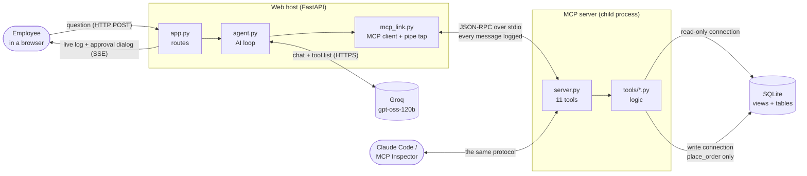
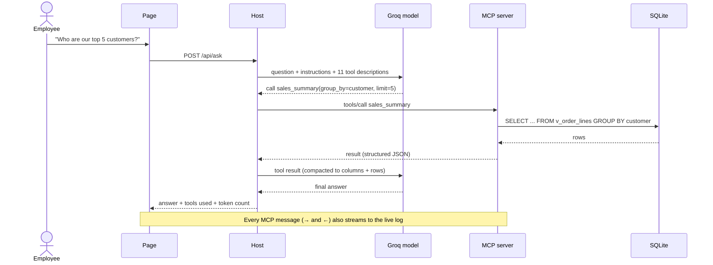
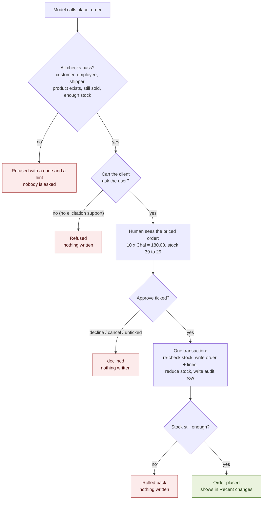
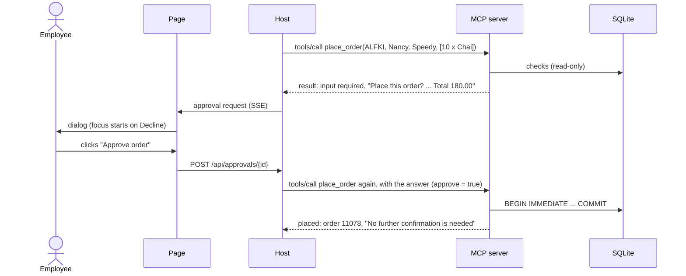
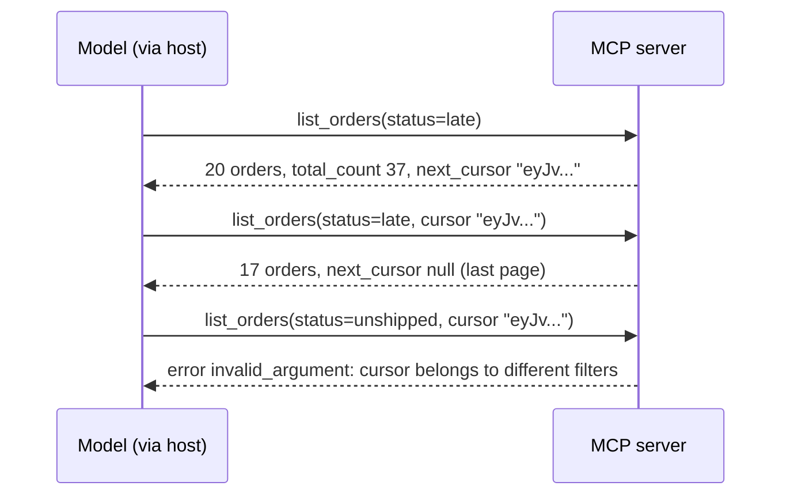
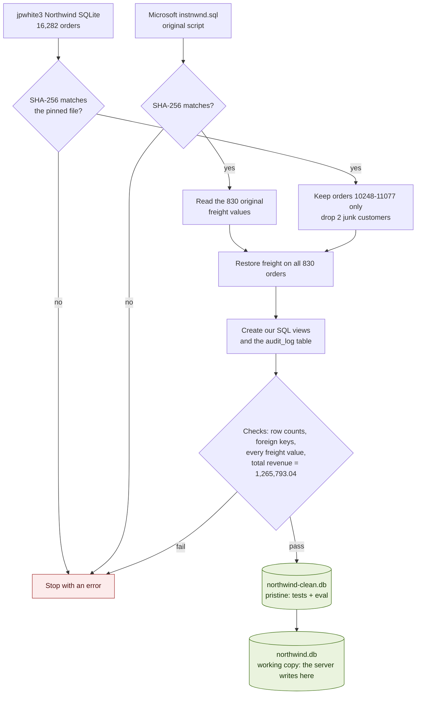
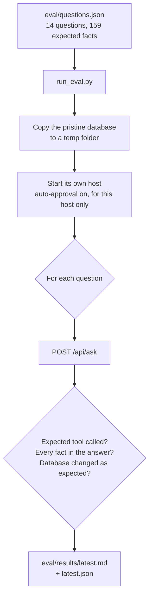
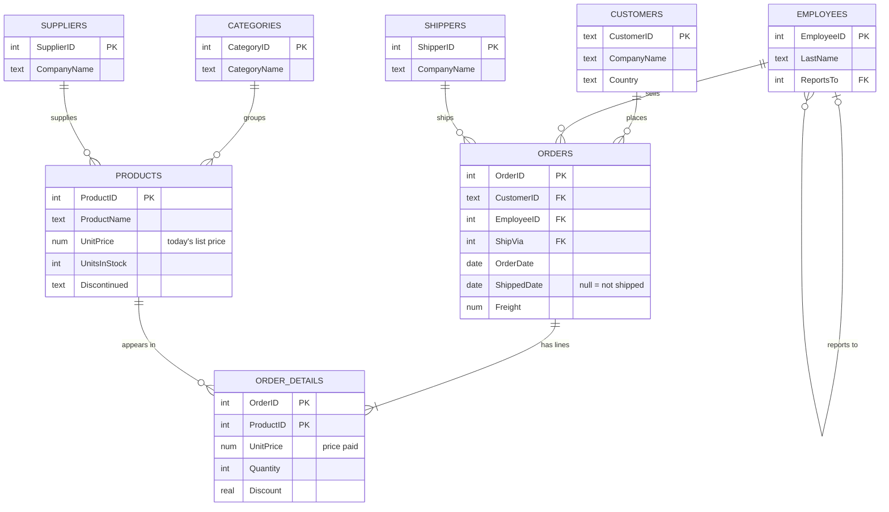

# How it works, in pictures

GitHub draws these diagrams automatically. Each one has a short explanation underneath.

## 1. The pieces and how they connect

- The **web host** is an MCP client. It starts the server as a child process and talks to it over stdio,
  the same way Claude Code and MCP Inspector do.
- Only the **server** touches the database. The host never opens it.
- **Groq** only decides which tool to call and writes the answer. Every fact comes from a tool result.

## 2. What happens when you ask a question

- The model can loop: call a tool, read the result, call another (up to 8 model calls).
  "Who does Suyama report to, and what were his 2017 sales?" takes two tools.
- The **sums are done by SQL on the server**, not by the model adding up rows.

## 3. Placing an order: every way it can end

- Red endings write nothing. Only the green path writes: all checks pass, a human approves, and the stock is still there.
- The approval is **not** a tool argument, so the model can't fill it in.

## 4. The approval, message by message (current spec, 2026-07-28)

- In the current protocol, the server **answers the first call with a question** instead of a result.
  The client asks the human and **calls again with the answer**. Both calls appear in the live log.
- Older clients (protocol 2025-11-25, like MCP Inspector) get a separate `elicitation/create` request
  instead. The same server code handles both.

## 5. Getting through a long list: cursor paging

- The cursor is an opaque bookmark. Inside, it holds the offset plus a fingerprint of the filters,
  so it can't be reused on a different query.
- `total_count` tells the model how many results exist before it pages.

## 6. How the database is built

- Both downloads are pinned to a commit and checked by hash, so the build gives the same result every time.
- The total revenue is the figure published for the original Northwind, which independently confirms the cleanup.

## 7. How the evaluation runs

- The expected answers were computed with **raw SQL on the original tables**, not the server's views,
  so the eval checks the server independently.
- Facts are compared ignoring formatting (`$`, thousands commas, accents, curly quotes, special dashes),
  and numbers must match within 0.01.

## 8. The data model

- Order lines hold the **price actually paid**. In 658 lines it differs from today's list price,
  which is why revenue is always computed from the order lines.
