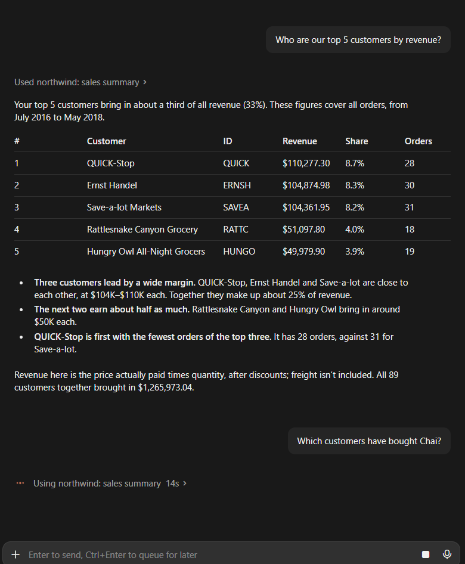
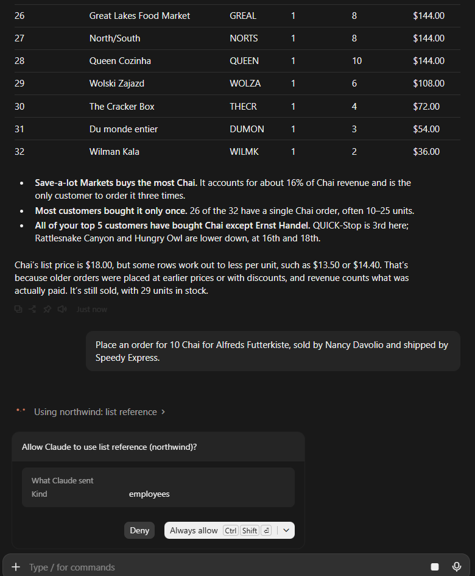
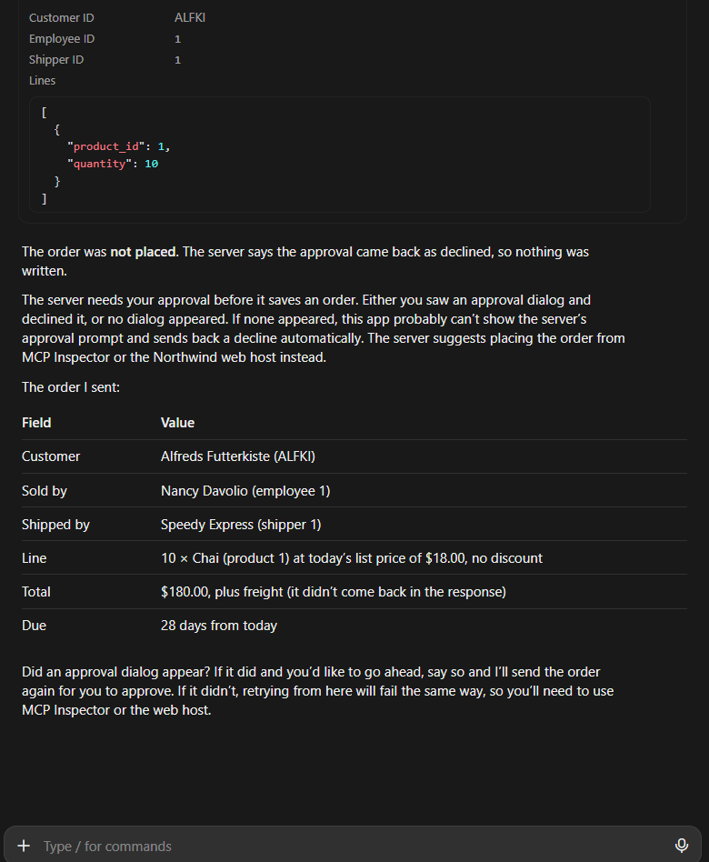
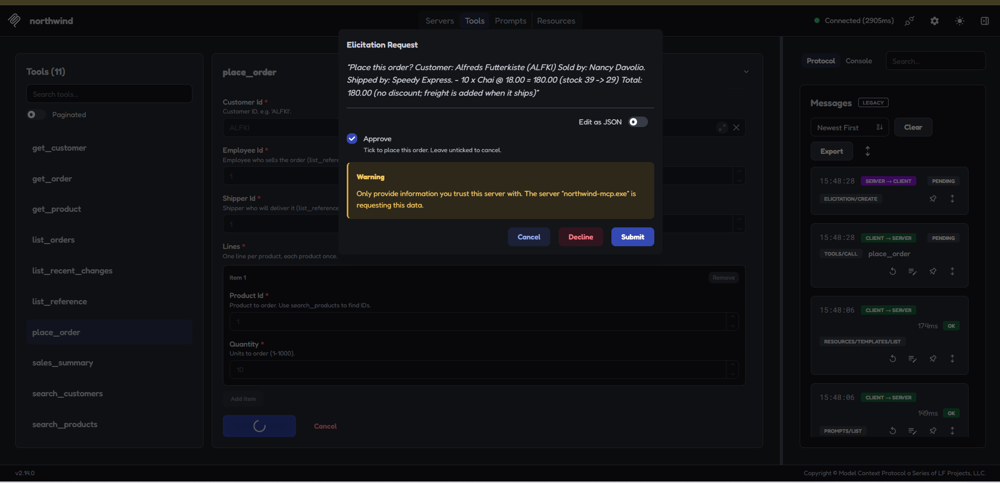
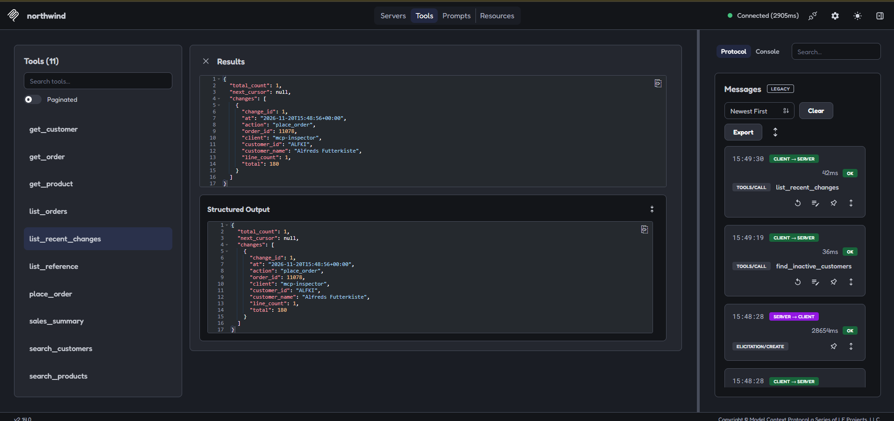

# Proof with real MCP clients

Two real clients, each started the server over stdio from its own configuration:

- **Claude Code** (an AI assistant): it chose and called the tools itself to answer plain questions.
- **MCP Inspector** (the protocol's official debugging client): a human called the tools directly,
  including the write and its approval form.

Screenshots of Claude Code are cropped to the conversation.

# Claude Code

Configured with a project `.mcp.json` that runs `northwind-mcp.exe`. The tools appear as `northwind: …`.

## 1. "Who are our top 5 customers by revenue?"

One call to `sales_summary`. All five customers, revenues and order counts are correct
(QUICK-Stop 110,277.30, Ernst Handel 104,874.98, Save-a-lot Markets 104,361.95, ...).

**One thing to note:** in its closing sentence the model wrote the grand total as "$1,265,973.04".
The tool returned `total_revenue: 1265793.04`, the published Northwind figure that our build script checks,
so the model swapped two digits when copying it. The server's number is right; the mistake happened in the
client's model. This is why the evaluation checks answers against fixed expected facts.

## 2. "Which customers have bought Chai?"

One call to `sales_summary(group_by="customer", product_id=1)`. Claude Code lists **32** customers, not the
31 in the evaluation, and that's correct here: this database already held order 11078 (10 Chai for Alfreds
Futterkiste), placed and approved a few minutes earlier in MCP Inspector (below). So a change made in one
client is visible to another. The model also explains why some Chai lines are cheaper than today's 18.00
list price: revenue uses the price actually paid. Below that, Claude Code asks permission for each tool
call, which is its own client-side safeguard.

## 3. "Place an order for 10 Chai for Alfreds Futterkiste, sold by Nancy Davolio and shipped by Speedy Express."

Claude Code found the IDs and called `place_order`, but **no approval dialog appeared**: this client
declares support for elicitation and then answers "decline" by itself. The server therefore wrote
nothing and returned its `declined` error. The model passed on the server's hint: if no dialog appeared,
the client can't ask the user, so use MCP Inspector or the web host. The server failed safe in a client
that can't ask a human, which is the intended behaviour (see DECISIONS.md).

# MCP Inspector

The Northwind server running in **MCP Inspector 2.14.0**, the official MCP client from the protocol's
maintainers. The Inspector starts the server over stdio (`northwind-mcp.exe`) on a freshly built database.
It negotiated the previous protocol version (2025-11-25, shown as "LEGACY"); our own web host uses the
current one (2026-07-28). The same server code handles both.

## 1. A write asks the human first

`place_order` for 10 Chai for Alfreds Futterkiste. Before anything is written, the server checked the
order and sent an `elicitation/create` request (server → client, right-hand log) showing the priced order
and the stock change (39 → 29). Nothing happens until the human ticks **Approve** and submits.
Decline, Cancel or an unticked box all leave the data unchanged.

## 2. The change is recorded and visible afterwards

After approval, `list_recent_changes` shows the audit entry: order **11078**, placed by the client
`mcp-inspector`, for Alfreds Futterkiste, total 180.00. The log shows the `elicitation/create` round trip
took about 28.6 seconds (the time the human took to decide).

## 3. Linked records in one call

`get_order(10248)` returns the customer, the employee who sold it, the shipper, and every line with the
price actually paid, joined by the server. The result is structured JSON (`structuredContent`) matching
the tool's output schema.
