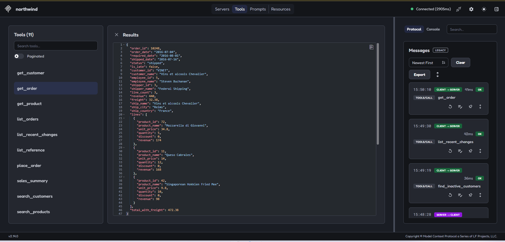

# Proof with a real MCP client

The Northwind server running in **MCP Inspector 2.14.0**, the official MCP client from the protocol's
maintainers. The Inspector starts the server over stdio (`northwind-mcp.exe`) on a freshly built database.
It negotiated the previous protocol version (2025-11-25, shown as "LEGACY"); our own web host uses the
current one (2026-07-28). The same server code handles both.

## 1. A write asks the human first

`place_order` for 10 Chai for Alfreds Futterkiste. Before anything is written, the server checked the
order and sent an `elicitation/create` request (server → client, right-hand log) showing the priced order
and the stock change (39 → 29). Nothing happens until the human ticks **Approve** and submits.
Decline, Cancel or an unticked box all leave the data unchanged.

## 2. The change is recorded and visible afterwards

After approval, `list_recent_changes` shows the audit entry: order **11078**, placed by the client
`mcp-inspector`, for Alfreds Futterkiste, total 180.00. The log shows the `elicitation/create` round trip
took about 28.6 seconds (the time the human took to decide).

## 3. Linked records in one call

`get_order(10248)` returns the customer, the employee who sold it, the shipper, and every line with the
price actually paid, joined by the server. The result is structured JSON (`structuredContent`) matching
the tool's output schema.
